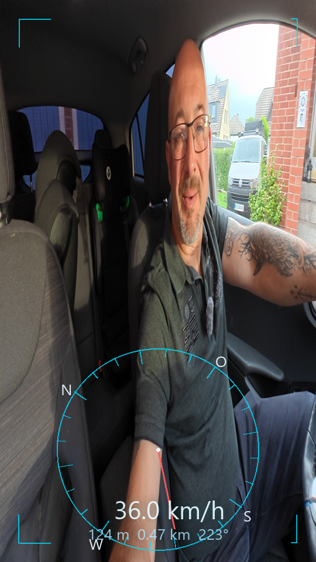

# Dashboard Design — InstaReframeX6 Telemetry / Telemetrie-Dashboard

## Two coupling modes / Zwei Kopplungsmoden

**Screen-static (statisch):** HUD elements stay fixed on screen. Numbers always readable,
independent of the reframe pan. Best for talking-to-camera / vlog footage.
→ `--layout minimal|full|map`

**World-anchored (ausrichtungs-gekoppelt, "holographic"):** Elements are anchored to real
world directions. When you pan the reframe view, the dashboard rotates with it:
- Compass ring: world bearing `b` appears at screen angle `b − pan` (N/O/S/W labels, ticks).
- Trail minimap: rotated heading-up.
- Speed label: flies in travel direction (`--text-anchor world`) or stays center (`screen`).
→ `--layout holo`

Verified: at pan 0/90/181 the needle points up/left/down, the speed label moves to the
travel direction (text angles −91°/−87°/−171°).

**Recommendation:** hybrid — numbers upright (readability), graphics world-anchored
(spatial feel). That is the current `holo` layout.

## Dashboard elements / Elemente

| Element | Anchor | Source |
|---|---|---|
| Speed km/h | screen center or world (travel dir) | GPX haversine per frame |
| Heading pointer + compass ring | world (rotates with pan) | GPX bearing |
| Altitude m, distance km | screen | GPX ele / cumulative |
| Trail minimap (heading-up) | world | GPX polyline, 2-min window |
| Corner brackets | screen | style |

## Rotation sync / Rotations-Synchronisation

The overlay must rotate exactly like the OFX reframe. Two ways:
1. `--pan "0:0,59:180"` — same keyframes you set on the PAN parameter.
2. `--pan-log C:/Users/stefa/AppData/Local/Temp/reframe_ofx.log` — the engine reads the
   actual `render t=... pan=...` values logged by the plugin. Guaranteed identical.
   Procedure: render the OFX clip once in Resolve, then run the engine with `--pan-log`.

## Timeline sync / Timeline-Synchronisation

Clip start = filename `VID_YYYYMMDD_HHMMSS` (camera local time). GPX is UTC → `--tz 2`
(CET/CEST). `--timeline` builds a Resolve timeline: clip on V1, overlay on V2, both at
recordFrame 0 → frame-exact sync.

## Ideas / Ausbaustufen (not yet implemented)

- Waypoint labels: GPX names anchored to world directions with distance ("Sottrum 3.2 km ↗").
- Ground ribbon: trail projected as perspective ribbon on the ground plane (true holographic).
- Pulse/fade animation, color themes (cyan/amber), per-element on/off toggles.
- G-force / gradient visualization from speed series.
- OFX-side rendering (Strategy B): Fusion data generator reads `telemetry.json`
  and draws the HUD inside the plugin — full keyframe integration, no second clip.

## Usage / Benutzung

```
python build_overlay.py --clip VID_20260929_083459_00_090.mp4 \
    [--gpx sidecar.gpx]            # auto: <clip>.gpx next to clip
    --layout holo --text-anchor world \
    --pan-log C:/Users/stefa/AppData/Local/Temp/reframe_ofx.log \
    --width 1080 --height 1920 --tz 2 --timeline
```


